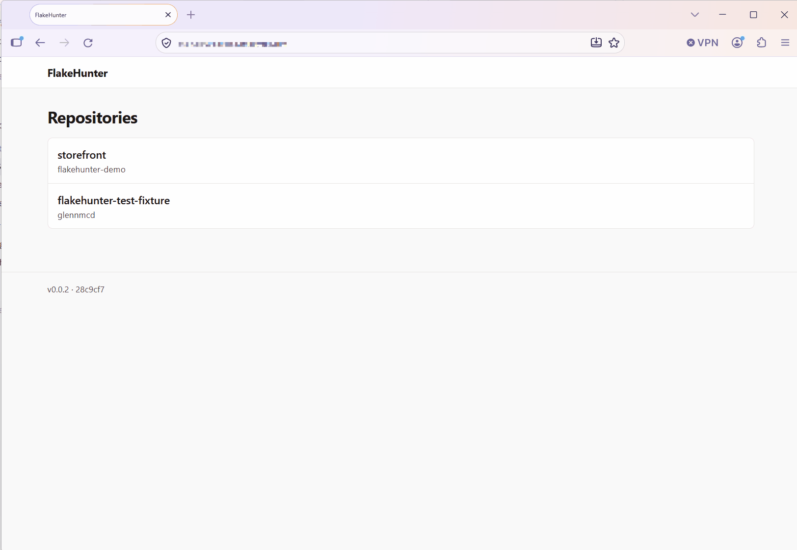
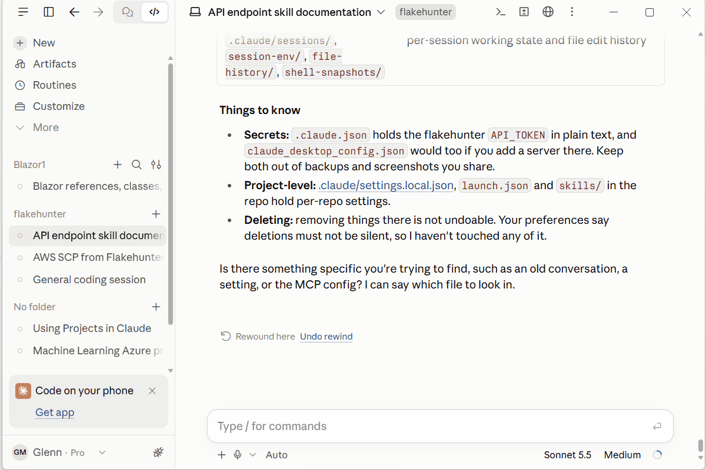
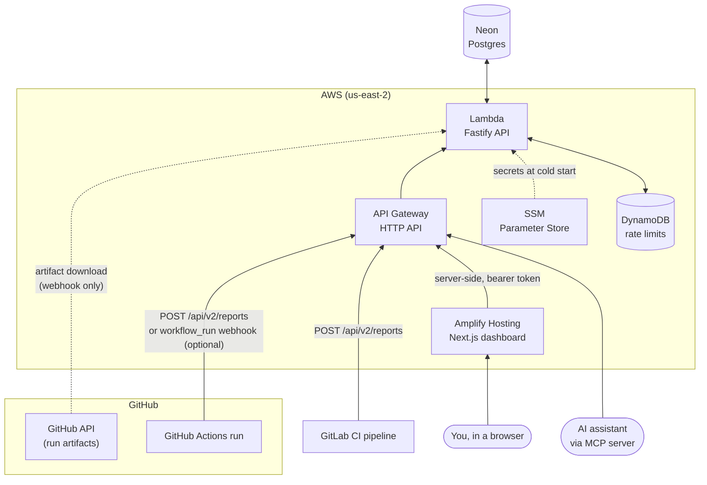
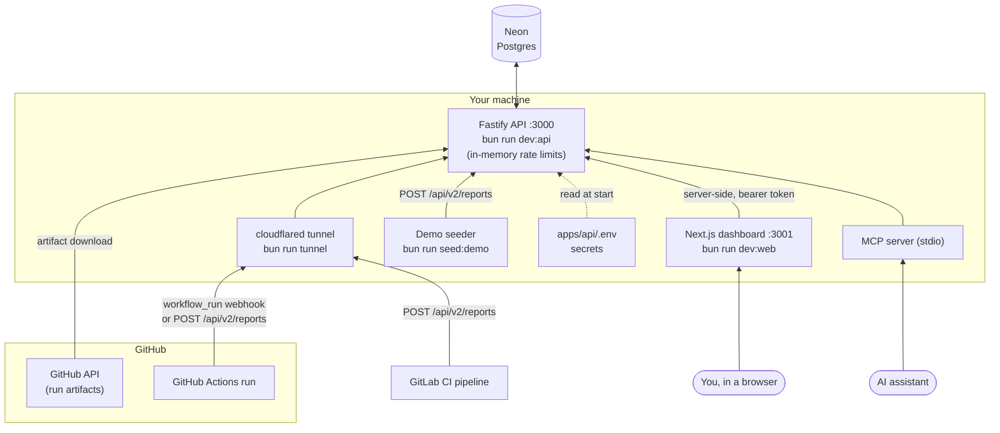

# FlakeHunter

**Find the flaky tests in your GitHub Actions or GitLab CI: any test that both passes and fails on the same commit.**

**[Live demo](https://flakehunter.g26work.com/)** 

**The dashboard:** a repo's flakiest tests, then one test's pass/fail history.



**The MCP server:** ask your AI agent about your flaky tests.



## How it works

- **Collects** JUnit XML from your CI. From GitHub Actions, a repo webhook pulls it from the workflow run's
  artifact, or one `curl` step pushes it. From GitLab CI, one `curl` step in the job pushes it, or the
  [flakehunter-airflow](https://github.com/glennmcd/flakehunter-airflow) DAGs pull it from finished pipelines.
- **Flags** a test as flaky when it has a pass and a fail on the same commit SHA, regardless of which workflow or job
  ran it. Same code, different result: no guessing from failure messages.
- **Ranks** tests by flake rate (flaky commits divided by commits the test ran on) in a dashboard and over an API,
  and answers an AI assistant's questions through an MCP server.

## Architecture

### Deployed on AWS



### Running locally



Locally, a quick tunnel gives GitHub and GitLab a public URL for the API, so no cloud resources are involved apart
from the Neon database. FlakeHunter's own unit tests need none of this: they run against in-memory PGlite.

## GitHub and GitLab

Each repository is registered with its host, `github` or `gitlab`, and each run records the CI system that produced
it, `github_actions` or `gitlab_ci`. A GitLab project is registered by its numeric project id and its full path,
which may be nested (`group/sub/project`). Flaky-test detection, the dashboard, the API and the MCP server work the
same for both.

| | GitHub Actions | GitLab CI |
| --- | --- | --- |
| Push from CI | `curl` step in the workflow | `curl` in the test job |
| Pulled for you | Repo webhook, or the flakehunter-airflow GitHub DAG | flakehunter-airflow GitLab DAG |

The webhook is GitHub-only. For GitLab, the [flakehunter-airflow](https://github.com/glennmcd/flakehunter-airflow)
DAG lists finished pipelines, downloads each job's artifacts archive and uploads the merged JUnit XML, counting a
job retry as a new attempt. The test job must list its JUnit file under `artifacts:paths`, not only
`artifacts:reports:junit`, because GitLab's API downloads only the archive. Use one path per project: an in-job
upload and the DAG number their runs differently, so the same tests would be stored twice.

Register a GitLab project and mint its upload token:

```bash
SEED_REPO_HOST=gitlab SEED_REPO_OWNER=<group> SEED_REPO_NAME=<project> SEED_REPO_EXTERNAL_ID=<project id> \
  bun run --env-file=apps/api/.env scripts/seed-dev-repo.ts
TOKEN_REPO_HOST=gitlab TOKEN_REPO_FULL_NAME=<group>/<project> \
  bun run --env-file=apps/api/.env scripts/create-repo-token.ts
```

To push from the pipeline instead, store the token as a masked CI/CD variable `FLAKEHUNTER_TOKEN` and upload after
the tests:

```yaml
run-tests:
  script:
    - bun test --reporter=junit --reporter-outfile=junit.xml
  after_script:
    - |
      gzip -c junit.xml | curl --fail-with-body -X POST "$FLAKEHUNTER_URL/api/v2/reports" \
        -H "Authorization: Bearer $FLAKEHUNTER_TOKEN" \
        -H "Content-Type: application/xml" \
        -H "Content-Encoding: gzip" \
        -H "X-FH-CI-Source: gitlab_ci" \
        -H "X-FH-Run-Id: $CI_JOB_ID" \
        -H "X-FH-Sha: ${CI_MERGE_REQUEST_SOURCE_BRANCH_SHA:-$CI_COMMIT_SHA}" \
        -H "X-FH-Branch: ${CI_MERGE_REQUEST_SOURCE_BRANCH_NAME:-$CI_COMMIT_REF_NAME}" \
        -H "X-FH-Workflow: $CI_JOB_NAME" \
        --data-binary @-
```

GitLab has no run attempt, so the job id serves as the run id: a retried job gets a new id and is stored as a new
run on the same commit, which is what lets a flake show up. `after_script` runs even when the tests fail, and the
job image needs `curl` and `gzip`. Header details are in [docs/api.md](docs/api.md).

## Stack

A TypeScript monorepo built with Bun:

- **API:** Fastify (`apps/api`)
- **Dashboard:** Next.js 16 and React 19 (`apps/web`)
- **MCP server:** `packages/mcp-server`, for AI assistants
- **Shared types:** Zod schemas used by both the API and the dashboard (`packages/shared-types`)
- **Database:** Postgres (Neon for dev and production, in-memory PGlite for tests, so tests need no database or
  network)
- **Infrastructure:** AWS CDK (`infra/`)

A Python repo, [flakehunter-airflow](https://github.com/glennmcd/flakehunter-airflow), pulls JUnit reports from CI
and uploads them through the API:

- **Pipelines:** Apache Airflow 3 DAGs, one for GitHub Actions and one for GitLab CI
- **API client:** generated with openapi-python-client from a pinned copy of `docs/openapi.v2.json`; a weekly
  workflow opens an issue when the contract moves
- **Tooling:** Python 3.12, uv, Ruff, pytest with respx (no network in tests)
- **Dev environment:** a dev container or Codespace that runs `airflow standalone`

## Security

Security best practices were used including but not limited to:

- Every endpoint except `/health` needs a bearer token or, for the GitHub webhook, a valid GitHub signature
- No secrets in code
- Data is schema validated and size limited
- AWS deployment specifies rate limiters, explicit SCP, kill switch, cost protection

The full list, the known gaps and how to report a vulnerability are in [docs/SECURITY.md](docs/SECURITY.md).

## Get started

- [Run it locally or deploy it to AWS](docs/deployment.md)
- [Send reports from GitHub Actions or GitLab CI, and the API reference](docs/api.md)
- [Use it from an AI assistant (MCP server)](packages/mcp-server/README.md)
- [AWS Organization guardrails (SCPs)](infra/scp/README.md)

## How I built this with Claude Code

FlakeHunter was built with [Claude Code](https://claude.com/claude-code). The project files that shaped how it worked:

- [`CLAUDE.md`](CLAUDE.md): the project's memory. Commands, architecture and the conventions that once caused bugs
  (route prefixes, extensionless imports, Node rather than Bun for CDK), so each session starts with what earlier
  ones learned.
- [`.claude/skills/new-endpoint`](.claude/skills/new-endpoint/SKILL.md): a skill for adding an `/api` endpoint
  test-first, so every route follows the same schema, registration and test steps.
- [`.claude/agents/code-reviewer.md`](.claude/agents/code-reviewer.md): a read-only reviewer for finished changes, so
  correctness and test gaps are checked by a fresh context that didn't write the code.
- [`.claude/agents/security-auditor.md`](.claude/agents/security-auditor.md): a read-only security audit for changes
  to auth, input handling, the database or dependencies, the parts an attacker reaches first.
- [`.claude/settings.json`](.claude/settings.json): a guardrail that denies `git commit`, so every change
  waits for my review and I make every commit myself.
- [`.claude/launch.json`](.claude/launch.json): the API and dashboard dev servers, so Claude Code can start them and
  check UI changes in its browser preview.

**Design notes:** each part was planned before any code was written. The [build plans](docs/plans/README.md) give the
prompt, the plan and what shipped for each part, and the [decision records](docs/decisions/README.md) explain the
choices behind them.

## License

[MIT](LICENSE).
